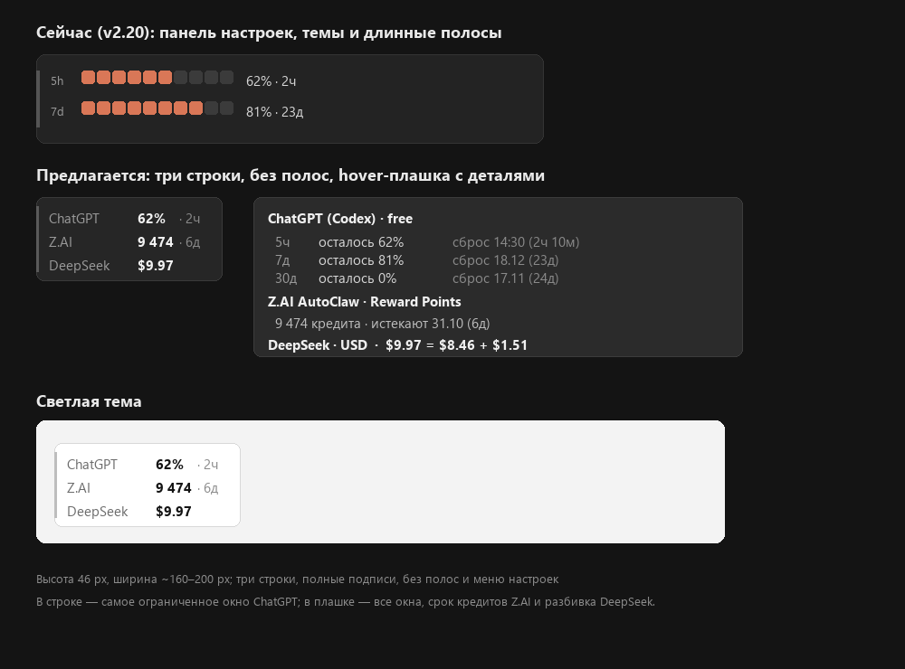

# Agent Limit Monitor — дизайн минималистичной версии

Дата: 2026-10-24  
База: форк `sstpnk/Claude-Code-Usage-Monitor`, ветка `main` = v1.4.9  
Статус: **MVP реализован** (v0.1.0). Exe — **943 616 байт**, 1–2 колонки, высота 42 px, hover-плашка, ChatGPT + Z.AI + DeepSeek + Claude + Antigravity + Copilot, taskbar-виджет с меню и tray-иконкой. Поведение taskbar/меню/tray — из v2.

---

## 0. Главное

1. **Ваш форк и приложение, которое установлено, — это разные версии.**
   - Форк на GitHub: **v1.4.9** (последний коммит 17.07.2026), release-exe **852 480 байт**.
   - Установленное приложение `C:\Apps\claude-code-usage-monitor.exe`: **v2.20.0**, exe **7 630 848 байт**, плюс 576 КБ тем в `%APPDATA%`.
   - Панель настроек, Theme Studio, Dashboard и «длинные полоски» — это v2. В форке v1.4.9 ничего этого нет: там только контекстное меню и две строки с сегментированными полосами.

2. **v2 не стоит «немного урезать».** Панель и полоски — это не надстройка, а ядро v2: `eframe/egui`, Theme Studio, theme engine, dashboard, 56,8 тыс. строк Rust против 7,2 тыс. в v1. Удаление панели = переписывание рендера и всей UI-части.

3. **Рекомендуемая база — v1.4.9.** Из неё получается ровно то, что нужно:
   - три строки без полос, каждая строка — провайдер, остаток и срок:
     ```
     ChatGPT   62% · 2ч
     Z.AI    9 474 · 6д
     DeepSeek  $9.97
     ```
   - высота 42 px, ширина считается по значениям (минимум 140 px), шрифт 11 px;
   - никакой панели настроек; все действия — в контекстном меню виджета/tray (обновление, частота, модели, обновление приложения, позиция, выход);
   - при наведении — большая плашка со всеми деталями (все окна ChatGPT, разбивка DeepSeek, срок кредитов Z.AI);
   - exe ~0,8–1,0 МБ вместо 7,6 МБ;
   - private bytes ~2–4 МБ, working set ~15 МБ (замер v1.4.9 на этой машине: 15,8 МБ WS / 2,4 МБ private / 6 потоков / 222 handles);
   - конфигурация — один маленький JSON, без GUI.

4. **Интеграции уже проверены на вашей машине:**
   - ChatGPT/Codex: endpoint `chatgpt.com/backend-api/wham/usage` отвечает; **но текущий `~/.codex/auth.json` — это free-план, 100% использовано, окно 30 дней, сброс 17.11.2026**, а не подписка 5h/7d. Код должен читать окно из ответа, а не хардкодить «5h/7d».
   - Z.AI AutoClaw: локальные credentials расшифрованы (DPAPI + AES-256-GCM), wallet вернул **9 474 кредита**, ledger показывает срок истечения **31.10.2026** (6 дней). Это рабочий путь, но внутренний API — риск.
   - DeepSeek: официальный `GET https://api.deepseek.com/user/balance`; `total_balance` = `topped_up_balance` + `granted_balance`; у вас ожидаемо **$9.97** ($8.46 + $1.51).

5. **Решения приняты:** база v1.4.9, ChatGPT как есть, AutoClaw credentials читаются, DeepSeek — env/config. См. §10.

### 0.1. Что уже реализовано

- `src/` переписан на шесть провайдеров: `providers/chatgpt.rs`, `zai.rs`, `deepseek.rs`, `claude.rs`, `antigravity.rs`, `copilot.rs`.
- Окно — 42 px, 1 колонка для 1–3 моделей и 2 колонки для 4–6; динамическая ширина, без полос; hover-плашка с полными деталями.
- Контекстное меню — «Обновить», «Частота обновления», «Модели», «Обновить приложение», «Версия», «Сбросить позицию», «Выход»; tray-иконка статическая и открывает то же меню.
- Конфиг — `%APPDATA%\AgentLimitMonitor\config.json` или `config.json` рядом с exe.
- ChatGPT: OAuth Codex + прямой `wham/usage`; при Cloudflare 403 — fallback через локальный Node.js.
- Z.AI: DPAPI + AES-256-GCM, wallet/ledger; opt-in refresh токена с DPAPI-кэшем.
- DeepSeek: `user/balance`, сумма `topped_up + granted`.
- Если `SetParent(taskbar)` запрещён (Windows 11/политика), включается taskbar-overlay: окно остаётся слева от области уведомлений, перетаскивается и сохраняет offset.
- Сборка: `build.bat build --release`; exe **943 616 Б**, private ~3,4 МБ, WS ~21 МБ.

Проверено: DeepSeek platform-баланс через DSH, ChatGPT free, Z.AI, переключение моделей/частоты, taskbar-embed, tray-иконка. Не проверено: Claude/Antigravity/Copilot без реальных входов, Z.AI refresh при истёкшем токене, ChatGPT-подписка, `explorer.exe` restart.

---

## 1. Замеры и факты

| Что | Значение | Комментарий |
|---|---:|---|
| Форк `main`, release v1.4.9 | 852 480 Б | exe, скачан с GitHub Releases |
| Установленный v2.20.0 | 7 630 848 Б | `C:\Apps\claude-code-usage-monitor.exe` |
| Темы v2 в `%APPDATA%` | 576 319 Б | `classic-usage-widget.json` и др. |
| Исходники v1.4.9 | 242 КБ Rust / 7 208 строк | 21 файл |
| Исходники v2.20.0 | 2,0 МБ Rust / 56 845 строк | 50+ файлов, egui, theme engine |
| v1.4.9 в работе | 15,8 МБ WS, 2,4 МБ private, 6 потоков, 222 handles | замер после старта и первого опроса, Windows 10/11, 100% DPI |

Замер v1 делался на копии release-exe с временным `%APPDATA%`, чтобы не трогать ваши настройки. Цифры WS включают разделяемые DLL; private — собственная память процесса. Точный замер RAM для v2 не делался; по составу (egui + Direct3D11 + разбор тем + dashboard) он ожидаемо в разы больше 2,4 МБ private у v1, но эту цифру надо снять отдельно перед выбором базы.

---

## 2. Что именно не нравится и что с этим делать

| Сейчас | В v2 | В новом приложении |
|---|---|---|
| Панель настроек | Dashboard (`--dashboard`), разделы Settings, Theme Studio, темы | Нет. Только `config.json` |
| Длинные полосы лимитов | Темизируемые progress-bar на 5h/7d | Нет. Только число и срок |
| Провайдеры | Claude, Codex, Antigravity, Copilot, Cursor, Grok, OpenCode | ChatGPT, Z.AI, DeepSeek, Claude, Antigravity, Copilot |
| Размер | 7,6 МБ exe, темы, egui | ~0,82 МБ exe, без тем |
| Настройка | GUI | JSON + переменные окружения + контекстное меню |

Контекстное меню сохраняет рабочие пункты v2: **Обновить**, **Частота обновления**, **Модели**, **Обновить приложение**, **Версия**, **Сбросить позицию**, **Выход**. Левый клик по tray-иконке скрывает/показывает виджет.

---

## 3. UX



*Значения на макете иллюстративные. У вас сейчас ChatGPT free-план: в виджете будет `0% · 24д`, а не `38% · 3д`.*

### 3.1. Три строки

```
┌────────────────────────────┐
│ ChatGPT     62% · 2ч       │
│ Z.AI      9 474 · 6д       │
│ DeepSeek     $9.97         │
└────────────────────────────┘
```

- Высота: **42 px** при 100% DPI, чтобы не выходить за taskbar.
- Ширина: считается по максимальным label/value/reset; минимум **140 px**, без фиксированной пустой зоны.
- Шрифт: Segoe UI Variable Text 11 px; hover — 11/12 px.
- Колонки: провайдер (приглушённый) → значение (яркое) → срок (приглушённый), по правому краю.
- Строки без разделителей; вместо них — вертикальный ритм.
- Полные подписи: `ChatGPT`, `Z.AI`, `DeepSeek`.
- Никаких полос, иконок, графиков.

Если taskbar ниже 42 px (Windows 10, 100%), включается `display.compact`: строки по 12 px, шрифт 10 px, высота 40 px. Вторая страховка — `display.dock: "floating"`.

### 3.2. Что показываем по каждому провайдеру

| Провайдер | Основное значение | Срок | Пояснение |
|---|---|---|---|
| ChatGPT (Codex) | **осталось %** = `100 − used_percent` | `reset_at` → `3д`, `2ч` | Окон может быть 1–3 (5ч/7д/30д). В строке — самое ограниченное или уже истёкшее; все окна — в подсказке |
| Z.AI AutoClaw | **кредиты** `total_balance` | `wallet_expires_at` из ledger → `6д` | Процента нет: wallet не отдаёт ёмкость. Показываем абсолютные кредиты |
| DeepSeek | **деньги** `topped_up + granted` | нет | `$9.97`; в подсказке — разбивка `$8.46 + $1.51` |

По типу аккаунта ChatGPT:
- free → бесплатные лимиты (сейчас 30 дней);
- Plus/Pro → квоты подписки (5ч + 7д, иногда 30д);
- API key → публичного остатка нет, показываем `ChatGPT —` (см. §5.1).

**Правило выбора окна ChatGPT** (по умолчанию `most_constrained`):
1. Если окно уже истекло (`reset_at <= now`) или `used_percent >= 100` — показываем его (самое раннее из истёкших).
2. Иначе — окно с минимальным остатком `100 − used_percent`.
3. При равенстве — окно с более ранним `reset_at`.

В подсказке перечисляются **все** окна, включая те, что не попали в строку. Конфиг `chatgpt.window` может переключить на `nearest_reset`, `primary` или `secondary`.

Если у ChatGPT появится подписка Plus/Pro, ответ сам придёт с окнами 5h/7d — код не меняется. Если останется free-план, будет `0% · 24д` и окно 30d.

### 3.3. Состояния

| Состояние | Вид | Когда |
|---|---|---|
| OK | `ChatGPT 38% · 3д` | успешный опрос |
| Мало | значение жёлтым | осталось ≤ 25% или денег ≤ $1; кредиты — только 0 |
| Критично | значение красным | 0%, $0, `is_available=false` |
| Устарело | значение серым, без срока | последний опрос не удался, показываем кэш |
| Нет входа | `ChatGPT —` | нет `auth.json`, токен истёк, нет ключа |
| API-ключ | `ChatGPT —` | `auth_mode=apikey`: остаток OpenAI не отдаёт |
| Загрузка | `ChatGPT …` | первый опрос ещё идёт |

Ошибка одного провайдера не скрывает остальные.

### 3.4. Подсказка при наведении

При наведении на виджет через ~300 мс появляется отдельная плашка с полными деталями. Это не стандартный `szTip`, а маленькое layered-окно без активации:

```
ChatGPT (Codex) · free
  5ч     осталось 62%    сброс 14:30 (2ч 10м)
  7д     осталось 81%    сброс 18.12 (23д)
  30д    осталось 0%     сброс 17.11 (24д)
Z.AI AutoClaw · Reward Points
  9 474 кредита · истекают 31.10 (6д)
DeepSeek · USD
  $9.97 = $8.46 пополнено + $1.51 бонус
```

- Ширина ~420 px, высота по числу строк; позиция — под виджетом, если не влезает — над ним; clamp по рабочей области монитора.
- `WS_EX_TOOLWINDOW | WS_EX_NOACTIVATE | WS_EX_LAYERED`, без захвата мыши: плашка не мешает кликам и не активирует окно.
- Показываются **все** окна ChatGPT, все ненулевые кошельки Z.AI, разбивка DeepSeek. Истёкшие окна — с пометкой «истёк».
- Скрывается при уходе курсора, клике, открытии меню, скрытии виджета. Таймер показа/скрытия — на UI-потоке, без сети.
- В tray tooltip остаётся короткая сводка (лимит 127 символов): `ChatGPT 0% 24д · Z.AI 9 474 6д · DeepSeek $9.97`.

Это ~250–350 строк на отдельное окно и отрисовку; DIB считается по содержимому (ширина 250–580 px), а не фиксированные 420 px.

### 3.5. Меню и tray

- Правый клик по виджету или tray: **Обновить**, **Частота обновления** (1/2/5/15/60 мин), **Модели** (ChatGPT/Z.AI/DeepSeek/Claude/Antigravity/Copilot), **Обновить приложение**, **Версия**, **Сбросить позицию**, **Выход**.
- Левый клик по tray: показать/скрыть виджет.
- Одна статическая tray-иконка; tooltip — сводка. Подменю «Модели» включает/выключает провайдеров, настройки сохраняются в JSON.
- «Обновить приложение» скачивает asset `agent-limit-monitor.exe` из GitHub Release, запускает cmd-скрипт замены и перезапуска; при ошибке открывает страницу релиза.

### 3.6. Конфигурация вместо панели

Файл: `%APPDATA%\AgentLimitMonitor\config.json`; если рядом с exe лежит `config.json` — используется он (portable-режим).  
Пример — в `config.example.json` и Приложении A.

Меняется вручную; приложение перечитывает файл при старте и по «Обновить». Ошибка JSON не роняет приложение: остаётся последняя рабочая конфигурация.

---

## 4. Архитектура

### 4.1. Дерево

```
src/
  main.rs            старт, single instance, --diagnose, --config
  config.rs          чтение/валидация/запись config.json + fallback рядом с exe
  models.rs          ProviderId, Reading, Value, State
  http.rs            ureq-обёртка (native-tls), таймауты, proxy из env
  format.rs          проценты, кредиты, деньги, countdown, локальная дата
  providers/
    mod.rs           последовательный опрос всех провайдеров
    chatgpt.rs       ~/.codex/auth.json + wham/usage + Node fallback
    zai.rs           AutoClaw credentials + wallet + ledger + DPAPI-кэш токена
    deepseek.rs      api.deepseek.com/user/balance
  window.rs          layered/taskbar окно, три строки, hover-плашка, drag, меню
  tray.rs            статическая иконка + контекстное меню
  updater.rs         проверка GitHub Releases, скачивание asset, замена exe
  native_interop.rs  wide_str, taskbar, layered/move, DPI
  theme.rs           is_dark_mode (реестр)
  diagnose.rs        --diagnose лог
```

Итого ~3 тыс. строк вместо 7,2 тыс. (и тем более 56,8 тыс.).

### 4.2. Модель

```rust
pub enum ProviderId { ChatGpt, Zai, DeepSeek }

pub enum Value {
    RemainingPercent(f64),             // 0..100
    Credits(u64),                      // 9_474
    Money { cents: i64, currency: Currency }, // 997, USD
}

pub struct Window {
    pub label: &'static str,           // "5ч" | "7д" | "30д"
    pub remaining: f64,                // 0..100
    pub reset_at: Option<SystemTime>,
    pub limit_reached: bool,
}

pub struct DetailLine {
    pub label: String,                 // "5ч" / "Reward Points" / "$"
    pub value: String,                 // "осталось 62%" / "9 474" / "$9.97"
    pub reset: Option<String>,         // "сброс 14:30 (2ч 10м)"
}

pub struct Reading {
    pub value: Value,                  // то, что в строке виджета
    pub reset_at: Option<SystemTime>,
    pub state: State,                  // Ok | Warning | Critical | Stale | Auth | Missing
    pub windows: Vec<Window>,          // все окна ChatGPT
    pub detail: Vec<DetailLine>,       // всё для hover-плашки
    pub updated_at: SystemTime,
}
```

`Reading` формируется в poll-потоке; UI только рисует готовые строки. Для ChatGPT `windows` содержит все окна, а `value`/`reset_at` — выбранное по правилу из §3.2. Для Z.AI/DeepSeek `windows` пуст, `detail` содержит разбивку.

```rust
pub trait Provider {
    fn id(&self) -> ProviderId;
    fn poll(&self, cfg: &ProviderConfig) -> Result<Reading, PollError>;
}
```

### 4.3. Поток данных

```
UI thread ── timer 120s ──► spawn poll thread
                              ├─ ChatGPT  (1 HTTP)
                              ├─ Z.AI     (1 HTTP wallet + 1 HTTP ledger раз в час)
                              └─ DeepSeek (1 HTTP)
                              │
                              └─ PostMessage(WM_APP_USAGE_UPDATED)
UI thread ◄──────────────────┘  перерисовать строку
```

- Опрос последовательный: три запроса, таймаут 10 с каждый; UI не блокируется.
- Один фоновый поток; никакого async runtime.
- Backoff при ошибке: 30 с → 60 с → 120 с, но не чаще обычного интервала; при auth-ошибке — пауза до изменения файла/ручного Refresh.
- Если reset прошёл — быстрый опрос через 5 с (как в v1).

### 4.4. Что удаляем из v1.4.9

| Файл/часть | Строк | Причина |
|---|---:|---|
| `src/updater.rs` | 510 | не нужен автообновлятор; экономия кода и сетевых запросов |
| `src/localization/*` (11 языков) | ~800 | строки на русском в одном `strings.rs`; без Windows Globalization |
| Claude Code + WSL + Antigravity в `poller.rs` | ~900 | не используются |
| Бары, сегменты, колонки моделей, `draw_row`/`draw_usage_bar` в `window.rs` | ~500 | заменяются тремя строками |
| Подменю Settings/Models/Language/Updates | ~250 | нет панели настроек |
| Процентные tray-бейджи | ~250 | одна статическая иконка |
| `show_*` флаги, `AppUsageData` на три поля | ~150 | заменяются `Vec<Reading>` |

Оставляем: taskbar-embed, drag, позиционирование, layered render, DPI, dark/light, single instance, `--diagnose`. Автозапуск с Windows не делаем: при необходимости — ярлык в `shell:startup`, это дешевле отдельного кода и реестра.

### 4.5. Что добавляем

- `aes-gcm` — расшифровка AutoClaw (RustCrypto).
- `base64` — Local State, JWT.
- `md-5` — подпись Z.AI (`X-Auth-Sign`).
- `windows` feature `Win32_Security_Cryptography` — DPAPI.
- ~150 строк на каждого провайдера + ~150 на расшифровку/подпись Z.AI.
- ~250–350 строк на hover-плашку (в `window.rs`): отдельное layered-окно, измерение текста, позиционирование, таймеры показа/скрытия.

Оценка exe: 852 КБ − удалённый код + 80–120 КБ новых крейтов ≈ **0,8–1,0 МБ**. Если выйдет >1,1 МБ — заменить `ureq` на WinHTTP (убрать native-tls), но это отдельный риск; начинать с проверенного `ureq`.

### 4.6. Почему не v2.20

| | v1.4.9 | v2.20 |
|---|---:|---:|
| exe | 0,85 МБ | 7,63 МБ |
| Rust-код | 7,2 тыс. строк | 56,8 тыс. строк |
| UI | Win32 + GDI | egui + Direct3D11 + theme engine |
| Панель настроек | нет (меню) | Dashboard + Theme Studio |
| Убрать панель | уже нет | переписать рендер и UI |
| RAM (private) | 2,4 МБ (замер) | не замерено; ожидаемо десятки МБ |

Если оставить v2 и вырезать только Dashboard/Studio, останутся egui, theme engine, dashboard-инфраструктура и 100+ КБ кода тем. Это больше работы и хуже результат, чем взять v1 и добавить три адаптера.

### 4.7. Обновление форка и ветки

- `main` форка можно обновить до upstream v2.20 — это полезно для истории, security-фиксов и справки. Но **lean-приложение делаем не из v2.20**, а из тега `v1.4.9` (текущий `main` форка) в отдельной ветке `lean`.
- Причина: v2 — это другая архитектура (egui/theme engine), её нельзя «уменьшить» до 1 МБ без переписывания. Обновление `main` не делает v2 легче.
- Если в v2 исправлен конкретный баг v1 (taskbar, DPI, explorer restart), его портируем точечно в `lean`, а не мержим v2 целиком.
- Практическая схема: `main` = upstream v2.20; `v1.4.9` = тег/ветка старой базы; `lean` = рабочая ветка от `v1.4.9`. Пушить в форк можно после локальной сборки.
- В текущем рабочем каталоге лежит распакованный v1.4.9 без git-истории; это baseline для `lean`, а не обновлённый `main`.

---

## 5. Интеграции

### 5.1. ChatGPT / Codex

**Auth:** `$CODEX_HOME/auth.json` или `~/.codex/auth.json`; нужен `tokens.access_token` и `tokens.account_id`. `auth_mode = apikey` не подходит для подписки — показываем `ChatGPT —`.

**Про API-ключ ChatGPT.** Если в `auth.json` нет OAuth-токенов, а только `OPENAI_API_KEY`, это не free-план и не подписка, а обычный API-ключ. Публичного endpoint «сколько токенов/денег осталось» для project key у OpenAI нет: `/v1/dashboard/billing/credit_grants` требует session key и устарел, Usage API — admin key и организация. Поэтому для такого режима показываем `ChatGPT —` и в hover «API-ключ: остаток не отдаётся». Если понадобится учёт API-токенов — это отдельная задача с admin key/бюджетом, не блокирует MVP.

**Cloudflare.** Прямой запрос из Rust (`ureq`/Schannel или rustls) может получать 403 — Cloudflare различает TLS-отпечаток. В реализации есть fallback: тот же запрос через локальный Node.js (`C:\Program Files\nodejs\node.exe`) с минимальным скриптом, токен передаётся через env, ответ парсится как обычный `WhamResponse`. Если Node нет — `ChatGPT —` с понятной ошибкой.

**Запрос:**
```http
GET https://chatgpt.com/backend-api/wham/usage
Authorization: Bearer <access_token>
ChatGPT-Account-Id: <account_id>
User-Agent: codex-cli
```

**Ответ (сокращённо, без user/email):**
```json
{
  "plan_type": "free",
  "rate_limit": {
    "allowed": false,
    "limit_reached": true,
    "primary_window": {
      "used_percent": 100,
      "limit_window_seconds": 2592000,
      "reset_at": 1794924965
    },
    "secondary_window": null
  },
  "credits": { "has_credits": false, "unlimited": false, "balance": null }
}
```

**Маппинг:**
- `remaining = clamp(100 - used_percent, 0, 100)`.
- Подпись окна из `limit_window_seconds`: ≤ 6 ч → `5ч`; ≤ 2 дней → `1д`; ≤ 8 дней → `7д`; ≤ 31 дня → `30д`; иначе `Nд`.
- В строке — окно по правилу §3.2 (истёкшее → минимальный остаток → ранний сброс); в hover-плашке — все окна, включая 5ч/7д/30д. Переключается `chatgpt.window`.
- `limit_reached = true` → критичный цвет, остаток 0.
- При 401/403 — попытаться обновить токен через `codex` CLI (как в v1), но не чаще раза в 10 минут; если CLI нет — `ChatGPT —` и подсказка «запустите codex login».

**Важно:** сейчас в вашем `auth.json` `plan_type = "free"` и окно 30 дней, поэтому в виджете будет не `5h/7d`, а `0% · 24д`. Если нужен Plus — войдите в Codex тем аккаунтом, где есть подписка; код это подхватит без изменений.

### 5.2. Z.AI AutoClaw

**Где лежит:**
```
%APPDATA%\AutoClaw-oversea-official\Local State
%APPDATA%\AutoClaw-oversea-official\accounts\<hash>\account-credentials.enc
```

**Расшифровка (проверена):**
1. `Local State` → `os_crypt.encrypted_key` (base64).
2. Убрать первые 5 байт `DPAPI`, вызвать `CryptUnprotectData` (CurrentUser) → 32-байтный ключ.
3. `account-credentials.enc`: первые 3 байта `v10`, затем 12-байтный nonce, ciphertext, последние 16 байт — GCM tag.
4. AES-256-GCM → JSON `{ accessToken: "Bearer ...", refreshToken: "...", updatedAt }`.
5. JWT payload даёт `exp`, `device_id`, `user_id`, `source_id`.

**Wallet:**
```http
GET https://autoglm-api.autoglm.ai/agent-assetmgr/api/v2/wallets?biz_app_id=autoclaw
X-Auth-Appid: 100003
X-Auth-TimeStamp: <unix seconds>
X-Auth-Sign: md5("100003&<ts>&38d2391985e2369a5fb8227d8e6cd5e5")
X-Product: autoclaw
X-Version: 1.9.1
X-Tm: win
X-Trace-Id: <uuid>
authorization: Bearer <access_token>   ← именно lowercase
```

**Ответ:**
```json
{"code":0,"data":{"total_balance":9474,"wallets":[
  {"public_wallet_type":"reward","display_name":"Reward Points","balance":9474}
]}}
```

**Срок:** ledger
```http
GET https://autoglm-api.autoglm.ai/agent-assetmgr/api/v1/ledgers_std?asset_type=point&wallet_type=all
```
В записях есть `wallet_expires_at` (unix). Ledger отсортирован новыми сверху, поэтому берём срок последней операции; если он уже в прошлом — максимальный будущий. Кэшируем на 1 час. Если ledger не ответил — показываем кредиты без срока, не ломая виджет. Это приблизительно: у разных начислений могут быть разные сроки, но для «когда сгорят основные кредиты» последняя операция — самый устойчивый ориентир.

**Обновление токена — это не интервал опроса.** `poll_interval_secs` управляет только тем, как часто мы читаем usage (по умолчанию 120 с). Access token AutoClaw живёт ~24 ч и лежит в `account-credentials.enc`; мы перечитываем этот файл на каждом опросе, поэтому:

- если AutoClaw открыт и сам обновил токен — виджет подхватит новый токен без перезапуска;
- если токен истёк, а AutoClaw давно не открывали — строка `Z.AI —`, в hover-плашке «откройте AutoClaw, он обновит токен»;
- сами refresh **не делаем** по умолчанию: `refresh_token` может ротироваться, и AutoClaw потеряет сессию. Риск сломать вход не стоит выгоды;
- опционально позже можно добавить `zai.refresh_token: true` — с хранением нового токена в DPAPI-файле и предупреждением, но по умолчанию `false`. В файлы AutoClaw не пишем никогда.

**Риски:** API внутренний, заголовок `X-Version` может измениться, формат `account-credentials.enc` — тоже. Всё изолировано в `providers/zai.rs`; при ошибке — fail-soft. Юридически это чтение локальных данных приложения и запрос к его же API; решение за вами.

### 5.3. DeepSeek

**Ключ:** основной источник — DeepSeek Harness: `~/.dsh/.credentials.yaml` → `deepseek-account-platform/default.token`, заголовок `x-dsh-auth-token` к `platform.deepseek.com/api/v0/users/get_user_summary`. Fallback — `DEEPSEEK_API_KEY` и официальный `api.deepseek.com/user/balance`. В `config.json` ключ не хранится; токен никогда не логируем.

**Запрос:**
```http
GET https://api.deepseek.com/user/balance
Authorization: Bearer <key>
Accept: application/json
```

**Ответ:**
```json
{"is_available":true,"balance_infos":[
  {"currency":"USD","total_balance":"9.97","granted_balance":"1.51","topped_up_balance":"8.46"}
]}
```

**Правило:** `remaining = topped_up_balance + granted_balance`; если строки не парсятся — `total_balance`. Считаем в центах, показываем `$9.97`. Если `is_available=false` — критичный цвет. Сброса нет; `reset_at = None`. При нескольких валютах берём USD (или `deepseek.currency` из конфига).

### 5.4. Сводка

| Провайдер | Auth | Метрика | Сброс | Обновление токена |
|---|---|---|---|---|
| ChatGPT | `~/.codex/auth.json` | осталось % | `reset_at` | `codex` CLI, редко |
| Z.AI | DPAPI + AES из AutoClaw | кредиты | `wallet_expires_at` | нет (по умолчанию) |
| DeepSeek | API key | деньги | нет | не требуется |

---

## 6. Размер и память

### 6.1. Бюджет

| Метрика | Сейчас v2.20 | Цель | Факт v0.1.0 |
|---|---:|---:|---:|
| exe | 7,63 МБ | ≤ 1,0 МБ | **943 616 Б** |
| Файлы в `%APPDATA%` | 576 КБ+ | ≤ 10 КБ | конфиг < 1 КБ |
| Private bytes | не замерено | ≤ 8 МБ | **~2,8 МБ** |
| Working set | не замерено | ≤ 20 МБ | **~17 МБ** |
| Потоки | — | ≤ 8 | 7 |
| Handles | — | ≤ 300 | 287 |
| GDI objects | — | ≤ 50 | не замерено |
| Старт до виджета | — | ≤ 150 мс | не замерено |

v1.4.9 даёт 15,8 МБ WS / 2,4 МБ private; фактическая сборка — 943 КБ exe и ~21 МБ WS. Главный выигрыш — отсутствие egui/D3D11/тем.

### 6.2. Что экономит память

- Нет egui/winit/D3D11/theme engine.
- Нет кэша тем (576 КБ JSON + разобранное дерево).
- Один фоновый поток, последовательные запросы.
- Строки форматируются раз в опрос, а не в каждом кадре.
- Один DIB на отрисовку виджета: ~140–260×42×4 ≈ 24–44 КБ; hover-плашка: ~250–580×150×4 ≈ 150–350 КБ.
- Нет автообновления, zip, image-крейтов.

### 6.3. Что может увеличить

- `aes-gcm` + `base64` + `md-5` — ~80–120 КБ к exe.
- Если оставить `ureq`/native-tls — уже учтено в 852 КБ v1.
- Ledger Z.AI — 48 КБ JSON раз в час; парсим в структуры и сразу отпускаем.

---

## 7. План работ

| Фаза | Что делаем | Результат | Оценка |
|---|---|---|---|
| 0 | Решение по базе и именам; ветка `lean` от v1.4.9 | зафиксированный план | 0,5 ч |
| 1 | Удалить updater, localization, Claude/Antigravity, бары, меню настроек; оставить taskbar-виджет и конфиг | пустой скелет ~0,7 МБ, три строки-заглушки | 1–1,5 дня |
| 2 | ChatGPT-адаптер, generic-модель окон, форматирование, состояния | `ChatGPT 38% · 3д` | 0,5–1 день |
| 3 | DeepSeek-адаптер, ключ, деньги, тесты | `DeepSeek $9.97` | 0,5 дня |
| 4 | Z.AI: DPAPI/AES, JWT, wallet, ledger, fail-soft | `Z.AI 9 474 · 6д` | 1–2 дня |
| 5 | Полировка: DPI, light/dark, hover-плашка, drag, reset-poll, ошибки | готовый виджет | 1–1,5 дня |
| 6 | Тесты, замер ресурсов, portable-сборка, README | exe + config + docs | 0,5–1 день |

Итого: **4–6 рабочих дней**; основной риск — Z.AI (внутренний API).

### 7.1. Сборка

Toolchain проверен:

- `rustc` / `cargo` **1.99.1** установлены в `%USERPROFILE%\.cargo\bin`; в PATH текущей DSH-сессии они не проброшены, поэтому вызывать лучше с префиксом пути.
- MSVC linker есть в **Visual Studio 2022 BuildTools** (`...\VC\Tools\MSVC\14.44.35207\bin\Hostx64\x64\link.exe`), но требует `vcvars64.bat`.
- Baseline v1.4.9 собран: `target\release\claude-code-usage-monitor.exe` = **863 232 байта** (release с GitHub — 852 480; разница из-за Rust 1.99.1).

Рабочая команда (локально используется `build.bat`):

```bat
call "C:\Program Files (x86)\Microsoft Visual Studio\2022\BuildTools\VC\Auxiliary\Build\vcvars64.bat"
set PATH=%USERPROFILE%\.cargo\bin;%PATH%
cargo build --release
```

CI-workflow не включён в репозиторий (у токена нет scope `workflow`); релиз v0.1.0 собран локально через `build.bat`.

### 7.2. Тесты

- Юнит: форматирование (`38%`, `9 474`, `$9.97`, `3д`), `remaining = 100 - used`, округление, парсинг денег в центы, countdown.
- Фикстуры JSON: ChatGPT free (30d), Plus (5h+7d), `secondary_window=null`, 401; Z.AI wallet/ledger, нет файла, битый blob; DeepSeek USD/CNY, `is_available=false`, несколько валют.
- Адаптеры с mock HTTP (trait `HttpClient`), без сети.
- AES-GCM roundtrip на тестовом ключе; DPAPI — только Windows, с временным blob.
- Ручной матрикс: 100/125/150/200% DPI; light/dark; taskbar сверху/снизу; explorer restart; sleep/resume; offline; 24h soak.
- Ресурсы: exe, private bytes, handles, GDI, CPU idle.

### 7.3. Приёмка

- На диске: exe ≤ 1,0 МБ; `%APPDATA%` ≤ 10 КБ.
- В памяти: private ≤ 8 МБ, WS ≤ 20 МБ.
- Нет панели настроек, нет полос, нет подменю Models/Settings/Language/Updates.
- До шести провайдеров в 1–2 колонках; ошибка одного не скрывает другие.
- Токены не попадают в лог; файлы AutoClaw не изменяются.
- Конфиг перечитывается; битый JSON не роняет приложение.

---

## 8. Риски

| Риск | Вероятность | Влияние | Мера |
|---|---|---|---|
| Внутренний API Z.AI изменится | средняя | высокое | изоляция в `zai.rs`, fail-soft, версия в конфиге, ручной токен как fallback |
| Формат `account-credentials.enc` изменится | средняя | высокое | проверка `v10`, понятная ошибка, не трогать файл |
| Refresh token AutoClaw ротируется | средняя | среднее | по умолчанию не обновлять; opt-in; не писать в AutoClaw |
| ToS AutoClaw запрещает чтение токена | средняя | высокое | решение пользователя; только чтение, без автоматизации аккаунтов |
| ChatGPT free вместо Plus | высокая (сейчас) | среднее | читать окно из ответа; показать план; подсказать re-login |
| DeepSeek-ключ утечёт | средняя | высокое | env, не логировать, предупреждение о plaintext |
| v1.4.9 содержит старые баги | средняя | среднее | портировать точечные фиксы v2; тестовая матрица |
| Taskbar/DPI на Win10/11 | средняя | среднее | использовать проверенный код v1; тесты |
| Нет автообновления | высокая | низкое | ручные релизы; версия в tray |

---

## 9. Что не делаем

- Не тащим egui, Dashboard, Theme Studio, темы, кастомные контекстные меню.
- Не делаем несколько аккаунтов на провайдера (одного достаточно; при необходимости — позже).
- Не делаем историю, графики, прогнозы, уведомления по расписанию.
- Не делаем автообновление и телеметрию.
- Не делаем настройки через GUI: только JSON/env.
- Не поддерживаем Claude/Antigravity/Copilot/Cursor/Grok/OpenCode.

---

## 10. Принятые решения и открытые вопросы

### Принято

1. **До шести моделей**: ChatGPT, Z.AI, DeepSeek, Claude Code, Antigravity, Copilot; 1 колонка для 1–3, 2 колонки для 4–6; высота 42 px, шрифт 11 px.
2. **Hover-плашка** с полными деталями обязательна; в строке — самое ограниченное/истёкшее окно ChatGPT.
3. **Z.AI:** можно читать и расшифровывать `account-credentials.enc`; автоматические кредиты.
4. **DeepSeek:** основной источник — токен DeepSeek Harness (`~/.dsh/.credentials.yaml`, `x-dsh-auth-token`), fallback — `DEEPSEEK_API_KEY`; в `config.json` не хранится.
5. **Claude/Antigravity/Copilot:** читаем существующие входы (Claude credentials, Windows Credential Manager, gh/env), без ключей в конфиге.
6. **Имя:** `Agent Limit Monitor`, данные в `%APPDATA%\AgentLimitMonitor`, single-instance mutex `Global\AgentLimitMonitor` — чтобы не конфликтовать с v2.
7. **Форк:** `main` можно обновить до upstream v2.20; `lean` — отдельная ветка от v1.4.9. См. §4.7.
8. **Toolchain:** проверен. `rustc`/`cargo` 1.99.1 установлены в `%USERPROFILE%\.cargo\bin`; MSVC linker есть в BuildTools 2022, но требует `vcvars64.bat`. Baseline v1.4.9 собрался, exe **863 232 байта** (Rust 1.99.1; release с GitHub — 852 480).
9. **ChatGPT показываем как есть:** free → бесплатные лимиты, подписка → квоты подписки, API key → `—` (публичного остатка нет). Перелогин не требуется.
10. **Z.AI refresh opt-in реализован.** По умолчанию перечитываем `account-credentials.enc`; при `refresh_token: true` обновляем OAuth и храним токен в DPAPI-файле приложения.
 
### Открыто

1. **DeepSeek-ключ.** Ключ в приложение не передаём: читается только `DEEPSEEK_API_KEY` из окружения. Пока переменная не задана, строка показывает `—`.
2. **ChatGPT API-key режим.** Если он вам реально нужен (не free/Plus), скажите: публичного остатка у OpenAI нет, но можно обсудить admin key/Usage API или локальный бюджет. В MVP этот режим показывает `—`.

---

## Приложение A. Пример конфига

См. `config.example.json`. Минимальный вариант:

```json
{
  "version": 1,
  "providers": {
    "chatgpt": {
      "enabled": true,
      "auth_path": "",
      "window": "most_constrained"
    },
    "zai": {
      "enabled": true,
      "account": "auto",
      "show_expiry": true,
      "refresh_token": false
    },
    "deepseek": {
      "enabled": true,
      "api_key_env": "DEEPSEEK_API_KEY",
      "currency": "USD",
      "use_platform_token": true
    },
    "claude": { "enabled": false, "auth_path": "" },
    "antigravity": { "enabled": false },
    "copilot": { "enabled": false }
  },
  "poll_interval_secs": 120,
  "display": {
    "metric": "remaining",
    "labels": "full",
    "dock": "taskbar",
    "compact": false
  },
  "position": { "taskbar_index": 0, "offset": 0 }
}
```

`auth_path: ""` = автоопределение. `labels: "short"` → `GPT`, `Z.AI`, `DS`. `dock: "floating"` — всегда-сверху полоска вместо встраивания в taskbar.

---

## Приложение B. Как воспроизвести замеры

```powershell
# размер exe
Get-Item .\agent-limit-monitor.exe | Select-Object Length

# память/потоки/handles
$p = Get-Process agent-limit-monitor
$p | Select-Object @{n='WS_MB';e={[math]::Round($_.WorkingSet64/1MB,1)}},
                   @{n='Private_MB';e={[math]::Round($_.PrivateMemorySize64/1MB,1)}},
                   @{n='Handles';e={$_.HandleCount}},
                   @{n='Threads';e={$_.Threads.Count}}

# содержимое %APPDATA%
(Get-ChildItem "$env:APPDATA\AgentLimitMonitor" -Recurse -File |
  Measure-Object Length -Sum).Sum
```

Для v1.4.9 замер дал 852 480 Б, 15,8 МБ WS, 2,4 МБ private, 222 handles, 6 потоков.

---

## Приложение C. Санитизированные ответы API

**ChatGPT (free):**
```json
{"plan_type":"free","rate_limit":{"allowed":false,"limit_reached":true,
 "primary_window":{"used_percent":100,"limit_window_seconds":2592000,"reset_at":1794924965},
 "secondary_window":null}}
```

**Z.AI wallet:**
```json
{"code":0,"data":{"total_balance":9474,"wallets":[
 {"public_wallet_type":"reward","display_name":"Reward Points","balance":9474}]}}
```

**Z.AI ledger (фрагмент):**
```json
{"amount":-2,"wallet_expires_at":1793442361,
 "description":"AutoClaw GLM-5.3-Flash model usage"}
```

**DeepSeek:**
```json
{"is_available":true,"balance_infos":[
 {"currency":"USD","total_balance":"9.97","granted_balance":"1.51","topped_up_balance":"8.46"}]}
```

---

## Приложение D. Почему не просто «убрать панель» из v2

v2 — это не v1 с добавленной панелью. Там:
- `eframe/egui` + `egui-winit` + `egui-directx11` + `winit`;
- `theme_engine.rs` ~3 тыс. строк и `theme_engine/tests.rs` ещё ~3,4 тыс.;
- `studio_app/*` ~10 тыс. строк (Theme Studio, инспекторы, настройки);
- `dashboard.rs`, `ui/*`, `theme_package.rs`, `image`, `zip`, `lucide-icons`;
- `window.rs` 3,9 тыс. строк с рендером тем.

Удаление только панели оставляет движок тем и egui, а виджет всё равно надо переписывать под «одну строку». Это больше работы, чем взять 7,2 тыс. строк v1 и добавить три адаптера. Поэтому рекомендация — v1.4.9.

