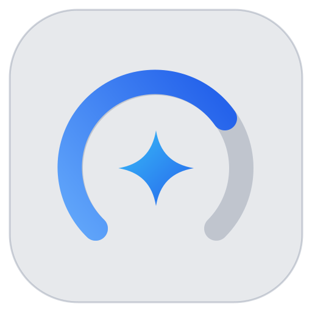
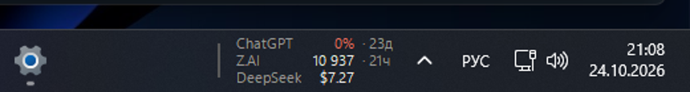
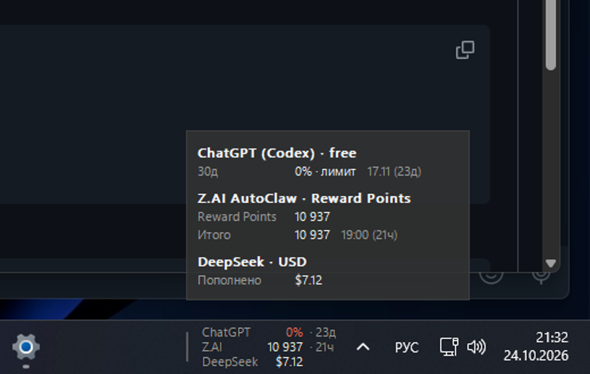
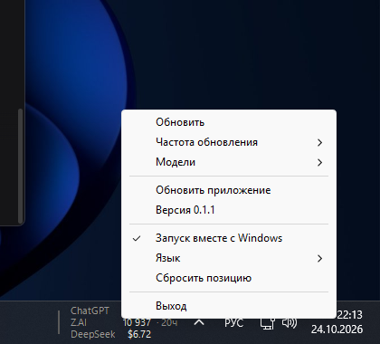

# Agent Limit Monitor



Компактный виджет для Windows: лимиты ChatGPT, кредиты Z.AI AutoClaw, баланс DeepSeek, квоты Claude Code, Antigravity и GitHub Copilot в одном окне. Без панели настроек, без полосок и тем.



При наведении — подробности по всем включённым моделям: окна лимитов, кредиты, баланс, квоты.



Правая кнопка по виджету или tray-иконке:



## Что показывает

| Провайдер | Значение | Источник |
|---|---|---|
| ChatGPT (Codex) | осталось % и срок сброса | `~/.codex/auth.json` → `chatgpt.com/backend-api/wham/usage` |
| Z.AI AutoClaw | кредиты и срок истечения | `%APPDATA%\AutoClaw-oversea-official` + wallet/ledger API |
| DeepSeek | деньги | DeepSeek Harness platform (`x-dsh-auth-token`) или `api.deepseek.com/user/balance` |
| Claude Code | 5ч/7д квоты | `~/.claude/.credentials.json` → `api.anthropic.com/api/oauth/usage` |
| Antigravity | квоты Gemini | Windows Credential Manager `gemini:antigravity` + Cloud Code API |
| GitHub Copilot | premium/chat квоты | `gh auth token`/`GH_TOKEN` → `api.github.com/copilot_internal/user` |

ChatGPT free/Plus/Pro определяется автоматически по ответу: free — бесплатные лимиты, подписка — квоты подписки. Если у аккаунта несколько окон (5ч/7д/30д), в строке показывается самое ограниченное или уже истёкшее, а в подсказке — все.

## Размер

- exe: **965 КБ**
- private bytes: ~3,5 МБ, working set: ~21 МБ (замер на Windows 11, 100% DPI)
- высота виджета 42 px, ширина считается по фактическим значениям; при >3 включённых моделях — две колонки
- шрифт Segoe UI Variable Text 11 px; для 中文 — Microsoft YaHei UI, для हिन्दी — Nirmala UI
- один фоновый поток опроса, без egui/WebView/тем

## Скачать

Готовый exe: [Releases v0.1.1](https://github.com/sstpnk/agent-limit-monitor/releases/tag/v0.1.1).

## Запуск

```powershell
.\agent-limit-monitor.exe
```

Полезные флаги:

```powershell
.\agent-limit-monitor.exe --diagnose           # лог рядом с exe или в %LOCALAPPDATA%\AgentLimitMonitor
.\agent-limit-monitor.exe --config C:\path\config.json
```

- Левый клик по tray-иконке — показать/скрыть виджет.
- Правый клик — **Обновить**, **Частота обновления** (1/2/5/15/60 минут), **Модели** (ChatGPT, Z.AI, DeepSeek, Claude Code, Antigravity, GitHub Copilot), **Обновить приложение**, **Версия**, **Запуск вместе с Windows**, **Язык**, **Сбросить позицию**, **Выход**.
- Виджет встраивается в taskbar слева от области уведомлений; перетаскивается за левую полоску, позиция сохраняется.
- Если Windows не разрешает `SetParent` в taskbar (например, ограниченный токен), включается taskbar-overlay: то же место, тот же вид, тоже перетаскивается.
- **Обновить приложение** проверяет GitHub Releases (при блокировке API — через Node.js), скачивает exe, заменяет текущий и перезапускает приложение.
- **Запуск вместе с Windows** добавляет/удаляет значение `AgentLimitMonitor` в `HKCU\Software\Microsoft\Windows\CurrentVersion\Run`.
- **Язык** — системный или один из: English, 简体中文, Español, हिन्दी, Français, Русский; выбор сохраняется в конфиг.

## Конфигурация

Файл: `%APPDATA%\AgentLimitMonitor\config.json`. Если рядом с exe лежит `config.json`, используется он (portable-режим). Пример — [config.example.json](config.example.json).

```json
{
  "language": "system",
  "poll_interval_secs": 120,
  "display": { "labels": "full", "dock": "taskbar", "compact": false },
  "position": { "taskbar_index": 0, "offset": 0 }
}
```

Полный пример со всеми провайдерами — в [config.example.json](config.example.json).

Основные поля:

- `language` — `system` или `en`, `zh`, `es`, `hi`, `fr`, `ru`;
- `providers.chatgpt.enabled` — показывать ChatGPT;
- `providers.zai.refresh_token` — `false` по умолчанию; `true` разрешает приложению обновлять OAuth-токен AutoClaw и хранить его в DPAPI-файле `%APPDATA%\AgentLimitMonitor\zai-token.bin`;
- `providers.deepseek.api_key_env` — имя переменной окружения (по умолчанию `DEEPSEEK_API_KEY`); ключ в конфиг не записывается;
- `providers.deepseek.use_platform_token` — читать баланс через DeepSeek Harness (`~/.dsh/.credentials.yaml`), по умолчанию `true`;
- `providers.claude.enabled` / `auth_path` — Claude Code; путь пустой = `~/.claude/.credentials.json`;
- `providers.antigravity.enabled` — Antigravity (Windows Credential Manager `gemini:antigravity`);
- `providers.copilot.enabled` — GitHub Copilot (`COPILOT_GITHUB_TOKEN`, `GH_TOKEN`, `GITHUB_TOKEN` или `gh auth token`);
- `poll_interval_secs` — 30–3600 секунд;
- `display.labels` — `full` или `short`;
- `display.dock` — `taskbar` или `floating`;
- `display.compact` — уменьшенная высота/шрифт для низкого taskbar.

### DeepSeek

Основной источник — DeepSeek Harness: приложение читает токен `deepseek-account-platform/default` из `~/.dsh/.credentials.yaml` и запрашивает `platform.deepseek.com/api/v0/users/get_user_summary` с заголовком `x-dsh-auth-token`. Это те же данные, что показывает `platform.deepseek.com/usage`; ключ в `config.json` не хранится. Если Harness не установлен, используется `DEEPSEEK_API_KEY` и официальный `api.deepseek.com/user/balance`.

Показываются только ненулевые компоненты; `Итого` выводится лишь когда компонентов два. Если кошелёк один, показывается одна строка — `Пополнено` (или `Бонус`) со сроком, без дублирующего `Итого`.

### Claude Code

Читается OAuth-токен из `~/.claude/.credentials.json` (или `CLAUDE_CONFIG_DIR`/`auth_path`), запрашивается `api.anthropic.com/api/oauth/usage`. Показываются окна `5ч` и `7д`; в строке — самое ограниченное. Если токен истёк — запустите `claude`, приложение подхватит новый файл.

### Antigravity

Токен лежит в Windows Credential Manager под target `gemini:antigravity`; приложение запрашивает Cloud Code API (`loadCodeAssist` + `retrieveUserQuotaSummary`). Показываются квоты Gemini; другие модели — в подсказке.

### GitHub Copilot

Токен ищется в `COPILOT_GITHUB_TOKEN`, `GH_TOKEN`, `GITHUB_TOKEN`, затем через `gh auth token`/`hosts.yml`. Запрашивается `api.github.com/copilot_internal/user`, показываются premium/chat/completions квоты. Для бесплатного тарифа используется `limited_user_quotas`.

### Z.AI AutoClaw

Приложение читает зашифрованный `account-credentials.enc` из `%APPDATA%\AutoClaw-oversea-official` (DPAPI + AES-256-GCM), запрашивает wallet и ledger. Файлы AutoClaw не изменяются.

Токен доступа AutoClaw живёт около 24 часов. По умолчанию приложение **не обновляет** его: если токен истёк — `Z.AI —`, откройте AutoClaw, и виджет подхватит новый токен при следующем опросе. Опция `refresh_token: true` включает самостоятельное обновление; новый токен хранится только в DPAPI-файле приложения.

Внутренний API Z.AI недокументирован и может измениться — это главный риск. Если положительный кошелёк один, в подсказке показывается только он и срок действия, без `Итого`.

### ChatGPT

Используется OAuth-токен Codex. Если прямой запрос к `chatgpt.com` блокируется Cloudflare (403), приложение один раз повторяет запрос через локальный Node.js (`C:\Program Files\nodejs\node.exe`) — у Node другой TLS-отпечаток. Node должен быть установлен; если его нет, ChatGPT покажет `—`.

Токен Codex не обновляется этим приложением. Если он истёк — запустите `codex login` (или воспользуйтесь Codex CLI), после чего нажмите «Обновить».

### API-ключ ChatGPT

Если в `auth.json` нет OAuth-токенов, а только `OPENAI_API_KEY`, это не free/Plus, а обычный API-ключ. Публичного остатка для него нет, поэтому строка показывает `—`. Для API-токенов используйте DeepSeek-провайдер или отдельный учёт.

### Языки

Меню и подписи виджета переведены на топ-5 мировых языков: English, 简体中文, Español, हिन्दी, Français, плюс Русский. «Системный по умолчанию» выбирает язык Windows. Выбор хранится в `language` и применяется сразу, без перезапуска.

### Автозапуск

Пункт **Запуск вместе с Windows** работает через `HKCU\Software\Microsoft\Windows\CurrentVersion\Run`; путь всегда указывает на текущий exe. Включение/выключение не требует прав администратора.

## Сборка

Нужны Rust (MSVC) и Visual Studio Build Tools с C++:

```bat
build.bat build --release
```

`build.bat` сам находит Build Tools и добавляет cargo в PATH. Результат:

```text
target\release\agent-limit-monitor.exe
```

Проверка:

```powershell
.\target\release\agent-limit-monitor.exe --diagnose
```

## Ограничения

- Нет панели настроек, истории и графиков — сознательно; всё управление в меню.
- Z.AI использует внутренний API и зашифрованный файл AutoClaw; при изменении формата провайдер мягко отключится (`Z.AI —`).
- ChatGPT зависит от Cloudflare; fallback требует Node.js.
- Claude/Antigravity/Copilot показываются только при наличии соответствующего входа; без него строка показывает `—`.
- Автообновление работает через GitHub Release с asset `agent-limit-monitor.exe`; v0.1.0 уже опубликован, следующие версии подхватятся автоматически.
- После перезапуска `explorer.exe` приложение нужно запустить заново; позиция сохраняется в конфиге.

## Лицензия

MIT. Форк основан на [Claude Code Usage Monitor](https://github.com/sstpnk/Claude-Code-Usage-Monitor).

